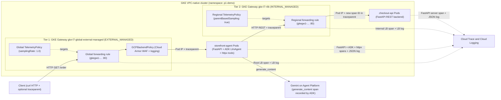

# GKE Load Balancer Distributed Tracing with a Google ADK Agent

Minimum-footprint GKE demo of the November 2, 2026 **Cloud Load Balancing Distributed Tracing with Cloud Trace (Preview)** release, combined with **GKE Managed OpenTelemetry (GA, October 29, 2026)**. A Google ADK agent behind a Global External Application Load Balancer calls a FastAPI service behind a Regional Internal Application Load Balancer, and every hop, both load balancers included, lands in one Cloud Trace waterfall with correlated Cloud Logging entries.

## Architecture



**Two tiers, both provisioned with the Kubernetes Gateway API** (`Gateway`, `HTTPRoute`, `HealthCheckPolicy`, `GCPBackendPolicy`), so GKE creates and manages the load balancers, health checks and container-native NEGs:

- **Tier 1** `p1-storefront-ext-gw` (`gke-l7-global-external-managed`): Global External ALB in front of `storefront-agent`. Cloud Armor WAF `p1-storefront-waf` is attached declaratively through `GCPBackendPolicy`; `/edge-404` is intentionally left unmatched on the `HTTPRoute` to show a span for a request that never reaches a Pod. `TelemetryPolicy` `p1-storefront-tracing-policy` (`location=global`, `samplingRate: 1.0`) mints the root W3C `traceparent` at the edge.
- **Tier 2** `p1-checkout-rilb-gw` (`gke-l7-rilb`): Regional Internal ALB in front of `checkout-api`. `TelemetryPolicy` `p1-checkout-tracing-policy` (`location=us-central1`, baseline `samplingRate: 0.01`, `parentBasedSampling.enabled: true` with `samplingRate: 1.0`) honours the upstream sampling decision.

Why Gateway API and not GKE Ingress: Ingress provisions a Classic ALB (`EXTERNAL`), which this Preview does not support; `TelemetryPolicy` only targets `EXTERNAL_MANAGED` / `INTERNAL_MANAGED` forwarding rules, and `parentBasedSampling` exists only on internal ALBs. During the Preview the policy is attached out of band with `gcloud beta network-services telemetry-policies import` against the Gateway's Compute Engine forwarding rule (`gkegw1-...`); no Kubernetes routing manifest changes.

**Telemetry plumbing**

- The cluster runs `1.37.1-gke.1697000+` (RAPID) with `--managed-otel-scope=COLLECTION_AND_INSTRUMENTATION_COMPONENTS`, DNS control-plane access only (`--enable-dns-access --no-enable-ip-access`, `get-credentials --dns-endpoint`), Gateway API and Workload Identity.
- `Instrumentation` CRs (`telemetry.googleapis.com/v1alpha1`) inject `OTEL_EXPORTER_OTLP_ENDPOINT=http://opentelemetry-collector.gke-managed-otel.svc.cluster.local:4318` and the other `OTEL_*` variables into both Deployments. No self-managed collector, no Google Cloud exporter code.
- `checkout-api` starts under `opentelemetry-instrument` and contains no OpenTelemetry setup code; `storefront-agent` lets ADK build its SDK from the same variables and adds the three lines ADK does not: `FastAPIInstrumentor.instrument_app(...)` (extract the inbound `traceparent` from the External ALB), `HTTPXClientInstrumentor().instrument()` (inject it into tool calls to the Internal ALB) and `set_global_response_propagator(TraceResponsePropagator())` (answer with a W3C `traceresponse` header carrying the server span's trace ID).
- Both services write trace-correlated Cloud Logging JSON to stdout (`structured_logging.py`), which is how Logs Explorer joins container logs to the load balancer logs under one trace ID.
- The ADK web UI (`http://<EXT_VIP>/`) and `GET /order` (one-command CLI verification; the trace ID comes back in the `traceresponse` response header, the JSON body holds only the agent's reply and tool calls) are both served by the agent.

## What you see in Trace Explorer

Every hop writes into the single waterfall started by the Global External ALB:

| Hop | Component | Spans | Source of instrumentation |
| :-- | :--- | :--- | :--- |
| 1 | Global External ALB (`gke-l7-global-external-managed` Gateway) | Root load balancer span | Global `TelemetryPolicy` (`scripts/03-enable-tracing.sh`) |
| 2 | `storefront-agent` Pod: ADK FastAPI front door | `GET /order` (or `POST /run_sse` from the web UI) server span | `opentelemetry-instrumentation-fastapi` + `Instrumentation` CR env vars |
| 3 | `storefront-agent` Pod: Google ADK 2.x | `invoke_agent storefront_agent`, `generate_content gemini-3.8-flash` (`gen_ai.usage.input_tokens` / `output_tokens`), `execute_tool place_order` | `google-adk[otel]` OTLP export to `gke-managed-otel` |
| 4 | `storefront-agent` Pod: outbound HTTP client | `POST` client span (injects W3C `traceparent`) | `opentelemetry-instrumentation-httpx` |
| 5 | Regional Internal ALB (`gke-l7-rilb` Gateway) | Internal load balancer span (`parentBasedSampling` honours hop 4's `sampled` flag) | Regional `TelemetryPolicy` (`scripts/03-enable-tracing.sh`) |
| 6 | `checkout-api` Pod: FastAPI REST backend | `POST /orders` server span | `opentelemetry-instrument` (SDK + FastAPI instrumentation configured entirely from the `Instrumentation` CR env vars) |

Gemini on Agent Platform does not write server-side spans into customer projects; model latency and token counts live in the `generate_content` span emitted inside `storefront-agent` by ADK's google-genai instrumentation. Both load balancers write first-party Google-managed proxy spans.

## Prerequisites

- `gcloud` updated (`gcloud components update`) so the Preview `gcloud beta network-services telemetry-policies` commands exist, plus `kubectl` and [`uv`](https://docs.astral.sh/uv/). Images are built by Cloud Build; no local Docker needed.
- Operator roles on the project: `roles/compute.networkAdmin` (or `compute.admin`), `roles/compute.loadBalancerAdmin`, `roles/compute.securityAdmin`, `roles/container.admin`, `roles/artifactregistry.admin`, `roles/cloudbuild.builds.editor`, `roles/iam.serviceAccountAdmin`, `roles/resourcemanager.projectIamAdmin`, `roles/cloudtrace.user` (or `roles/owner` on a sandbox project).
- Load balancer spans need `roles/cloudtrace.agent` and `roles/telemetry.tracesWriter` on **both** the Compute Engine service agent and the Network Security service agent; the workload identity service account needs those two plus `roles/logging.logWriter` and `roles/aiplatform.user`. `scripts/01-infra-iam.sh` grants all of them and enables the required APIs (Compute, GKE, Artifact Registry, Cloud Build, Network Security, Network Services, Cloud Trace, Telemetry, Logging, Monitoring, Vertex AI).
- Vertex AI access to `GEMINI_MODEL` (default `gemini-3.8-flash`) in `GOOGLE_CLOUD_LOCATION` (`global` in the manifest); change either in `k8s/20-storefront-agent-gw.yaml` if the model is not served there.
- Quota for one `e2-standard-4` node in `ZONE`, one global and one regional external IP range (Gateway-managed), and a `REGIONAL_MANAGED_PROXY` subnet in `REGION`.

## Quickstart

Run from the repository root:

```bash
cp .env.example .env   # set PROJECT_ID (and REGION/ZONE if not us-central1/us-central1-a)
./scripts/01-infra-iam.sh
./scripts/02-build-deploy-gke.sh
./scripts/03-enable-tracing.sh
./scripts/04-run-demo-checks.sh
```

What each script does:

1. `01-infra-iam.sh`: APIs, service-agent and workload-identity IAM, least-privilege node/build service account, custom VPC with a proxy-only subnet, firewall for Google Front Ends and health checkers, Cloud Armor policy, GKE cluster with Managed OpenTelemetry.
2. `02-build-deploy-gke.sh`: Artifact Registry, two Cloud Build image builds tagged with a UTC timestamp (`SKIP_BUILD=1 IMAGE_TAG=<tag>` redeploys an existing build), `k8s/` manifests (namespace, `Instrumentation` CRs, both Gateways), waits for both VIPs and for the External ALB to start enforcing the WAF rule.
3. `03-enable-tracing.sh`: discovers each Gateway's forwarding rule and imports the two `TelemetryPolicy` resources from `policies/*.tmpl`.
4. `04-run-demo-checks.sh`: runs Scenarios A to G and prints a Trace Explorer link for each trace ID.
5. `99-cleanup.sh`: ordered teardown (policies, Gateways while the cluster is alive, cluster, network, registry, IAM).

## Demo scenarios

Trace Explorer and Logs Explorer screenshots with measured durations is in [docs/DEMO_RESULTS.md](docs/DEMO_RESULTS.md); section numbers below refer to it.

| Scenario | What it proves | How it is triggered | Where to look |
| :-- | :--- | :--- | :--- |
| A (§2) | Six-hop waterfall: External ALB, `GET /order`, `invoke_agent`, `generate_content`, `execute_tool place_order`, httpx `POST`, Internal ALB, `POST /orders` | `curl http://$EXT_VIP/order` with no trace header | Trace Explorer, trace ID from the `traceresponse` response header |
| B (§7) | Upstream `traceparent` continuity across both Gateways, the agent and `checkout-api` | Same request with a client `traceparent` | The `traceresponse` header carries the client's trace ID |
| C (§6) | Edge-only span for a request that never reached a Pod | `GET /edge-404` (unmatched `HTTPRoute`) | One External ALB span with status 404, zero Pod spans |
| D (§4) | Internal ALB honours the upstream sampling flag despite its 0.01 baseline | Two requests to the RILB from an in-cluster Pod, `sampled=1` and `sampled=0` | First trace exists with an Internal ALB span; second does not |
| E (§8) | One trace ID joins load balancer logs and container logs | `gcloud logging read 'trace="projects/.../traces/<id>"'` | `http_load_balancer`, `internal_http_lb_rule` and `k8s_container` entries together |
| F (§5) | Cloud Armor deny traced at the edge | `GET /order` with `x-demo-attack: true` | One External ALB span (403, status OK, see Limitations below) joined to the `enforcedSecurityPolicy` log entry |
| G (§1, §3) | Outage and latency attribution | `checkout-api` scaled to 0, then `GET /order?delay_ms=1500` | 503 at the Internal ALB with zero `checkout-api` spans; 1.5 s isolated inside `POST /orders` |
| H (§7b) | An OpenTelemetry-instrumented client is the root above the External ALB span | `uv run scripts/06-run-otel-client.py` from the laptop | Script polls Cloud Trace and prints PASS when the ALB span's parent is the client span |

## Adapting to other ALB types

Tier 1 uses a Global External ALB and Tier 2 a Regional Internal ALB. The `TelemetryPolicy` parameters for all four Application Load Balancer types in the Preview:

| ALB type | GKE GatewayClass | Scheme | `TelemetryPolicy --location` | `telemetryTarget.resources` URI | `parentBasedSampling` |
| :--- | :--- | :--- | :--- | :--- | :--- |
| Global external (Tier 1) | `gke-l7-global-external-managed` | `EXTERNAL_MANAGED` | `global` | `//compute.googleapis.com/projects/PROJECT_ID/global/forwardingRules/FR_NAME` | Not supported |
| Regional external | `gke-l7-regional-external-managed` | `EXTERNAL_MANAGED` | `REGION` | `//compute.googleapis.com/projects/PROJECT_ID/regions/REGION/forwardingRules/FR_NAME` | Not supported |
| Regional internal (Tier 2) | `gke-l7-rilb` | `INTERNAL_MANAGED` | `REGION` | `//compute.googleapis.com/projects/PROJECT_ID/regions/REGION/forwardingRules/FR_NAME` | Supported |
| Cross-region internal | `gke-l7-crilb` | `INTERNAL_MANAGED` | `global` | `//compute.googleapis.com/projects/PROJECT_ID/global/forwardingRules/FR_NAME` | Supported |

## Limitations

- Load balancer tracing is a Preview. `TelemetryPolicy` cannot be expressed in Gateway API resources yet, so `scripts/03-enable-tracing.sh` imports it against the Gateway's Compute Engine forwarding rule. If a `Gateway` listener changes, GKE may recreate the forwarding rule under a new `gkegw1-...` name; re-run the script to re-import.
- Edge 403 (Cloud Armor) and 404 (unmatched route) spans carry only `http.request.method` and `http.response.status_code`, and their status stays OK: under OpenTelemetry HTTP server semantics only 5xx marks a server span as failed. Filter Trace Explorer on `http.response.status_code = 403` and open the linked `http_load_balancer` log entry for the `enforcedSecurityPolicy` details.
- The `Instrumentation` CR decides which signals each service exports (default: traces, metrics and logs over OTLP). `checkout-api` therefore also exports FastAPI HTTP metrics to Cloud Monitoring; set `otelSDKConfig: {meter_provider: null}` on `checkout-api-instrumentation` to stop that. ADK ignores `OTEL_METRICS_EXPORTER=none` and always exports over OTLP/HTTP, so keep the CRs on the HTTP protocol.
- Application logs reach Cloud Logging through stdout JSON, not through the OTLP collector; `kubectl logs` keeps working and nothing is ingested twice.

## Cleanup

Delete all `p1-*` resources (`TelemetryPolicy` resources, GKE Gateways, GKE cluster, Cloud Armor WAF, firewall, subnets, VPC, Artifact Registry, Cloud Build bucket, and IAM service accounts):

```bash
./scripts/99-cleanup.sh
```

## References

- [Cloud Load Balancing release notes, November 2, 2026](https://docs.cloud.google.com/load-balancing/docs/release-notes#November_02_2026)
- [Distributed tracing overview](https://docs.cloud.google.com/load-balancing/docs/distributed-tracing-overview) and [Trace inbound traffic with Cloud Trace](https://docs.cloud.google.com/load-balancing/docs/trace-inbound-traffic)
- [`gcloud beta network-services telemetry-policies import`](https://docs.cloud.google.com/sdk/gcloud/reference/beta/network-services/telemetry-policies/import)
- [Managed OpenTelemetry for GKE](https://docs.cloud.google.com/kubernetes-engine/docs/concepts/managed-otel-gke) and [Deploy Managed OpenTelemetry for GKE](https://docs.cloud.google.com/kubernetes-engine/docs/how-to/managed-otel-gke)
- [Deploy Gateways on GKE](https://docs.cloud.google.com/kubernetes-engine/docs/how-to/deploying-gateways) and [Configure Gateway resources and policies](https://docs.cloud.google.com/kubernetes-engine/docs/how-to/configure-gateway-resources)
- [ADK: Cloud Trace integration](https://adk.dev/integrations/cloud-trace/index.md), [ADK: agent activity traces](https://adk.dev/observability/traces/index.md), [ADK on Google Cloud](https://adk.dev/get-started/google-cloud/index.md)
- [`eggboy/gke-adk-otel`](https://github.com/eggboy/gke-adk-otel), the ADK + GKE Managed OpenTelemetry reference this agent follows
