# Demo Results: Cloud Load Balancing Distributed Tracing on GKE Gateway

Live run on **2026-11-05 19:04 HKT (11:04 UTC)** in project `gke-tracing-jay`, captured from Cloud Trace Explorer and Logs Explorer.

| Item | Value |
| :--- | :--- |
| Cluster | `p1-lb-trace-gke`, GKE `1.37.1-gke.3020000` (RAPID), 1x `e2-standard-4`, `us-central1-a`, DNS-only control plane |
| External ALB (Gateway API `gke-l7-global-external-managed`) | `34.54.17.196`, forwarding rule `gkegw1-6hkw-p1-demo-p1-storefront-ext-gw-bujflew2imh5`, Cloud Armor `p1-storefront-waf` |
| Internal ALB (Gateway API `gke-l7-rilb`) | `10.128.0.5`, forwarding rule `gkegw1-6hkw-p1-demo-p1-checkout-rilb-gw-ojenaxb407nj` |
| `TelemetryPolicy` | External: `samplingRate: 1.0`. Internal: `samplingRate: 0.01` + `parentBasedSampling {enabled: true, samplingRate: 1.0}` |
| Workloads | `storefront-agent` (ADK `2.13`, `gemini-3.8-flash` via `GOOGLE_CLOUD_LOCATION=global`) and `checkout-api` (FastAPI), both exporting OTLP to GKE Managed OpenTelemetry (`gke-managed-otel`) |
| Command | `./scripts/04-run-demo-checks.sh` after `01-infra-iam.sh`, `02-build-deploy-gke.sh`, `03-enable-tracing.sh` |

Reading the waterfalls: spans with an empty **Service/workload** column are emitted by the load balancers (`cloud.resource.id` = the forwarding rule). `GET /order` and `GET http://34.54.17.196/*` are the External ALB; `POST /` and `POST http://10.128.0.5/*` are the Internal ALB. Everything labelled `storefront-agent` or `checkout-api` comes from the Pods.

---

## 1. Scenario G2: 1,500 ms latency attribution (trace `6f43190c5099dfc79177225b3e99f935`)

`GET /order?delay_ms=1500` makes `checkout-api` sleep 1.5 s inside `POST /orders`.

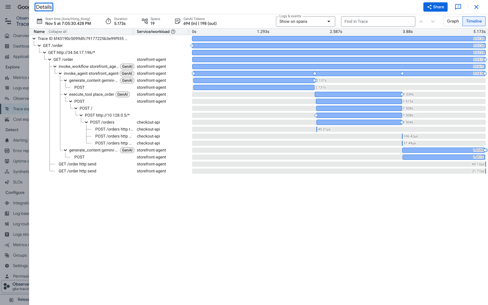

| Span | Emitter | Duration |
| :--- | :--- | :--- |
| `GET /order` | External ALB | 5.173 s |
| `GET /order` | storefront-agent | 5.167 s |
| `generate_content gemini-3.8-flash` (call 1) | storefront-agent | 2.137 s |
| `POST /` | Internal ALB | 1.508 s |
| `POST http://10.128.0.5/*` | Internal ALB (backend) | 1.508 s |
| `POST /orders` | checkout-api | 1.504 s |
| `generate_content gemini-3.8-flash` (call 2) | storefront-agent | 1.458 s |

Read directly off adjacent spans: Internal ALB overhead is about 4 ms, External ALB overhead about 6 ms, Gemini 3.6 s, and the injected 1.5 s sits inside `checkout-api`. No log join is needed to split proxy time from application time.

## 2. Scenario A: full 6-hop waterfall, no client trace header (trace `bf53601177d05a9bcd24eab73fd964be`)

`curl http://34.54.17.196/order` with no `traceparent`. The agent received `traceparent: 00-bf536011...-9cfa40f15a2f0ca4-01`, minted by the External ALB.

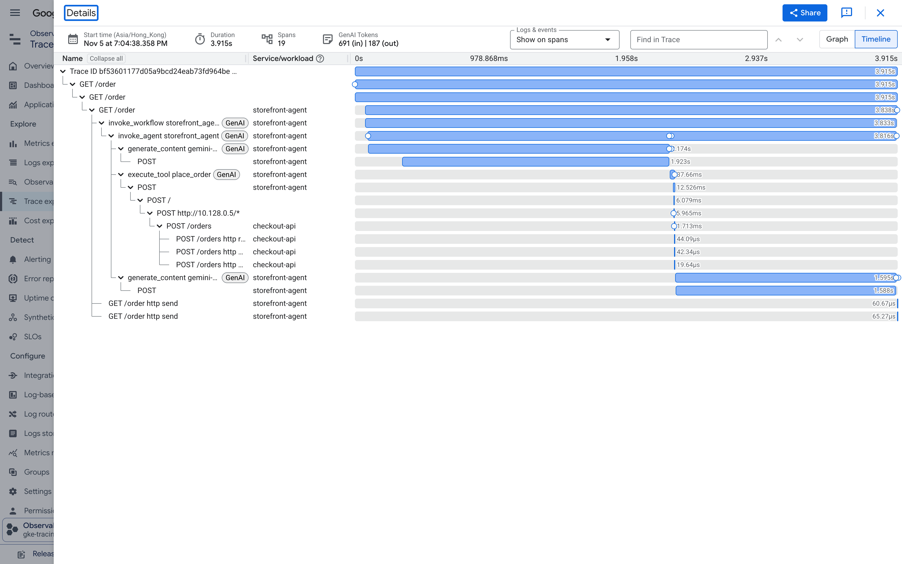

- 19 spans, 3.915 s end to end, 691 input and 187 output tokens shown in the trace header.
- Root span is the load balancer (`GET /order`, 3.915 s), then `storefront-agent` (3.838 s), `invoke_agent storefront_agent`, two `generate_content gemini-3.8-flash` calls (2.174 s and 1.595 s), `execute_tool place_order` (37.66 ms), the httpx `POST`, Internal ALB `POST /` (6.079 ms), and `checkout-api` `POST /orders` (1.713 ms).
- The trace starts at the edge, not at the Pod. On Azure Application Gateway the trace would begin at the Pod and the gateway hop would exist only in `AGWAccessLogs` under a `transactionId` that is not a W3C trace ID.

## 3. Scenario G1: internal backend outage (trace `3e2c8c31d576182c2ec8d99746632c08`)

`checkout-api` scaled to 0 replicas, then `GET /order`.

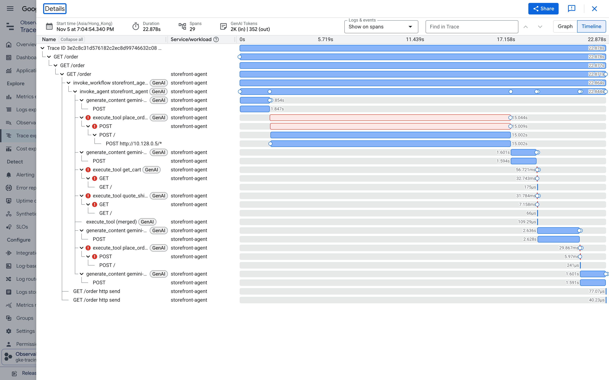

- First `place_order`: the Internal ALB span `POST /` lasts 15.002 s with **no `checkout-api` child span**; the LB recorded `http.response.status_code: 0` because the agent's httpx client gave up at its 15 s timeout while the LB was still trying a draining endpoint. The agent-side `POST` and `execute_tool place_order` spans are flagged red (our tool records the exception on the span).
- The agent then retried `get_cart`, `quote_shipping`, and `place_order`: each Internal ALB span (`GET /`, `POST /`) returned `503` in 175 to 241 microseconds, which is the "no healthy backend" fast path once the NEG was empty.
- Total 22.878 s, 29 spans. The outage is placed at the Internal ALB with zero backend spans, inside the same trace as the agent's tool calls.

## 4. Scenario D: internal ALB honors the upstream sampling flag

Two direct calls from inside the cluster to `http://10.128.0.5/carts/cart-1001`, with hand-made `traceparent` headers that differ only in the last byte.

### `traceparent: 00-ec73d8a9...-1111111111111111-01` (sampled=1)

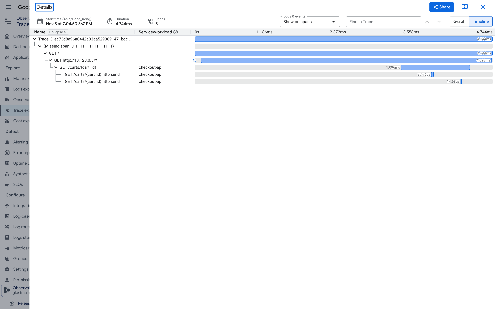

5 spans recorded (`GET /` 4.744 ms, `GET http://10.128.0.5/*` 4.628 ms, `GET /carts/{cart_id}` 1.096 ms). The parent shows as "Missing span ID 1111111111111111", the synthetic client span we put in the header.

### `traceparent: 00-96ee5a51...-2222222222222222-00` (sampled=0)

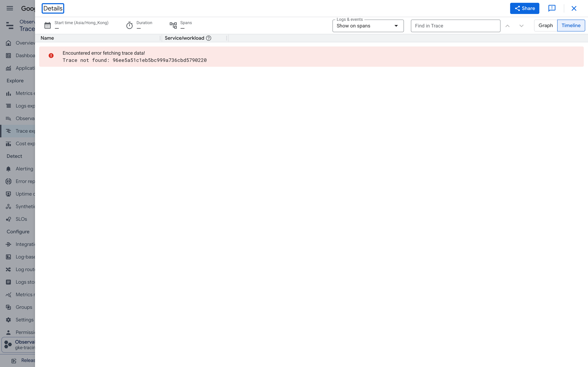

"Trace not found", even though the request returned `200` and the policy has a 1 percent baseline rate. The Internal ALB follows the W3C sampling decision the way an OpenTelemetry SDK does, so there are no orphan LB spans for unsampled requests.

## 5. Scenario F: Cloud Armor WAF deny at the edge (trace `4e5cb4cfcf86e7c3568ba52a62b39f72`)

`curl -H 'x-demo-attack: true' http://34.54.17.196/order` returns `403` from Cloud Armor rule 1000.

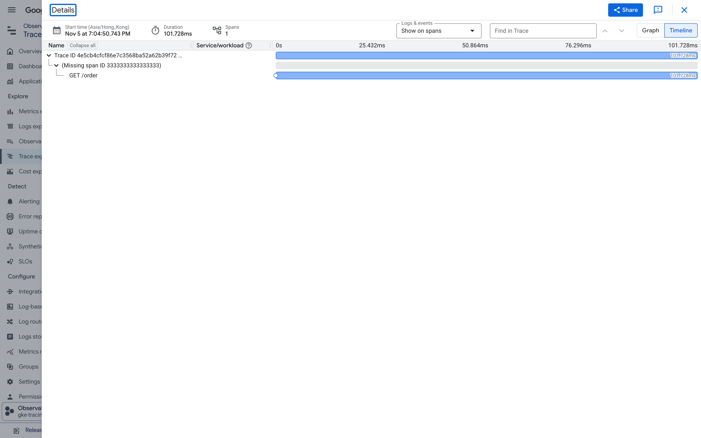

One span, 101.728 ms, no Pod spans. The span status is not Error: load balancer spans follow OpenTelemetry HTTP server semantics, where only 5xx marks a server span as failed. Find these in Trace Explorer with the filter `http.response.status_code = 403`.

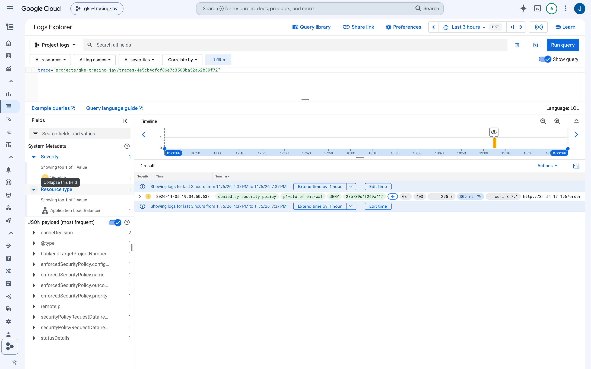

The Cloud Armor detail lives in the `http_load_balancer` log entry, found with the same trace ID: `statusDetails: denied_by_security_policy`, `enforcedSecurityPolicy.name: p1-storefront-waf`, `outcome: DENY`, `spanId: 28b739d4f269a417`, `GET 403`.

## 6. Scenario C: unmatched route at the edge (trace `d4f984ff5054bc1b7a277ce35836bf56`)

`/edge-404` is not in the `HTTPRoute`, so the External ALB answers `404` itself.

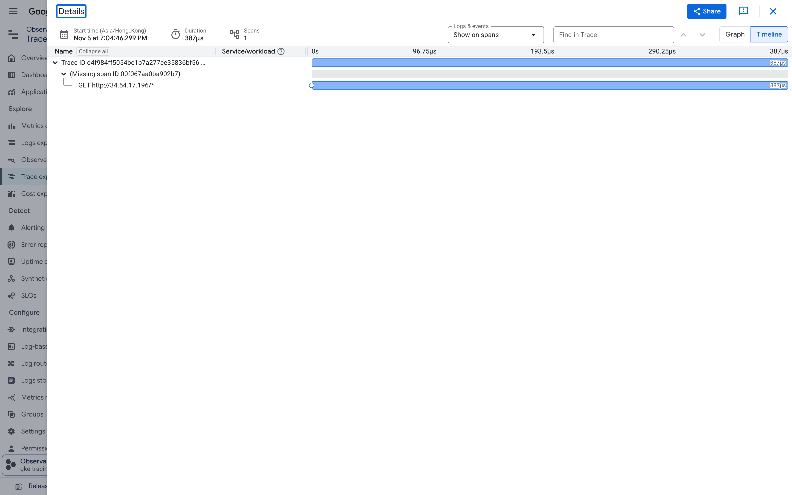

One span, 387 microseconds, zero Pod spans. The request never entered the cluster and still has a trace.

## 7. Scenario B: upstream `traceparent` continuity (trace `63a46f8cd749d1cbfcbf4885b04ba8bf`)

Client sends `traceparent: 00-63a46f8c...-00f067aa0ba902b7-01`.

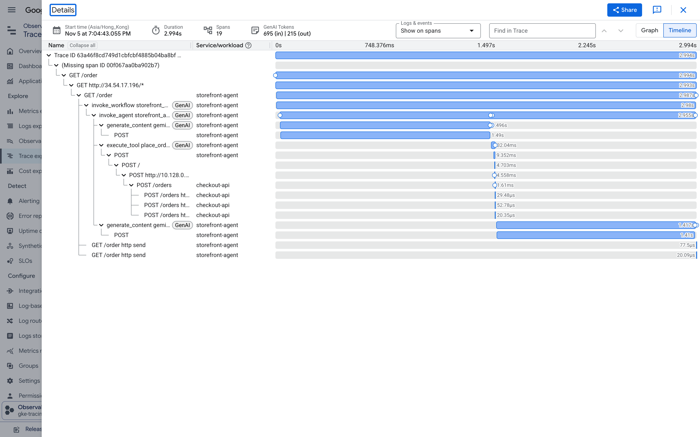

The whole 19-span tree hangs under "Missing span ID 00f067aa0ba902b7", the client's span. Both load balancers, the ADK agent, Gemini calls, and `checkout-api` all kept the client's trace ID (the trace ID the agent returned to the client matched it; today that is the `traceresponse` response header). The placeholder appears because `curl` has no tracer and never exported its own span; Scenario H closes that gap.

## 7b. Scenario H: OpenTelemetry-instrumented client, end to end (trace `4ca3fbf78d8affe555d83ef34a8178eb`)

`scripts/06-run-otel-client.py` runs on the laptop with the OpenTelemetry SDK and `httpx` instrumentation, exports its own spans to Cloud Trace (OTLP over HTTP to `telemetry.googleapis.com`), and calls `http://34.54.17.196/order`. This is the production shape: a traced caller, a load balancer in between, an agent behind it.

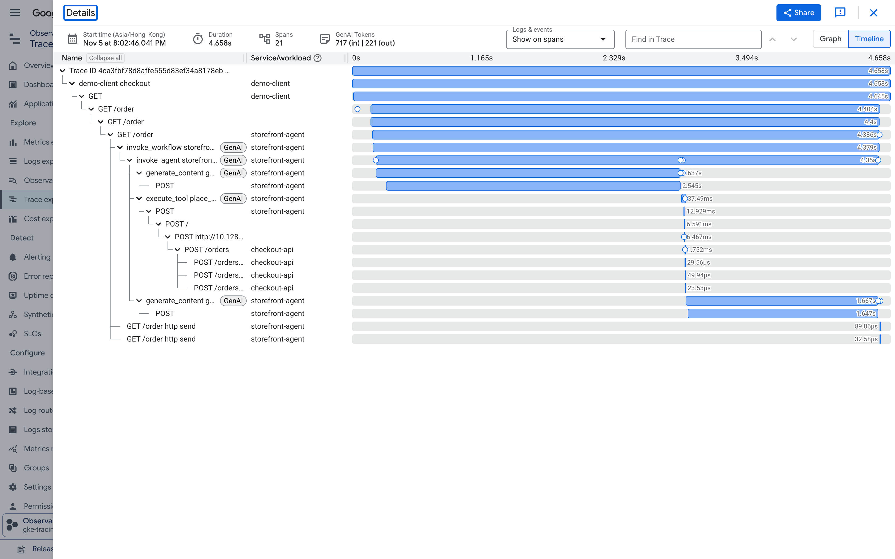

| Span | Emitter | Duration |
| :--- | :--- | :--- |
| `demo-client checkout` | demo-client (laptop) | 4.658 s |
| `GET` (httpx client span, injects `traceparent`) | demo-client (laptop) | 4.645 s |
| `GET /order` | External ALB | 4.404 s |
| `GET /order` | storefront-agent | 4.386 s |
| `POST /` | Internal ALB | 6.591 ms |
| `POST /orders` | checkout-api | 1.752 ms |

- 21 spans under one trace ID; the root is the client's own span, and the External ALB span's parent is the client's httpx `GET` span (verified through the Cloud Trace API by the script: `PASS: External ALB span is parented under the demo-client span tree`).
- The gap between the client `GET` (4.645 s) and the LB span (4.404 s) is about 240 ms of laptop-to-Google-front-end network time, now visible as its own slice of the waterfall.
- The `traceparent` the Pod received (`00-4ca3fbf7...-d9b90ad7181dbb60-01`) carries the LB's span ID, not the client's: the LB consumed the client context, emitted its own span, and issued a new child context downstream, exactly as an instrumented service would.

Run it with:

```bash
uv run scripts/06-run-otel-client.py --ext-vip 34.54.17.196
```

## 8. Scenario E: one trace ID, logs from every hop (trace `bf53601177d05a9bcd24eab73fd964be`)

Logs Explorer query: `trace="projects/gke-tracing-jay/traces/bf53601177d05a9bcd24eab73fd964be"`.

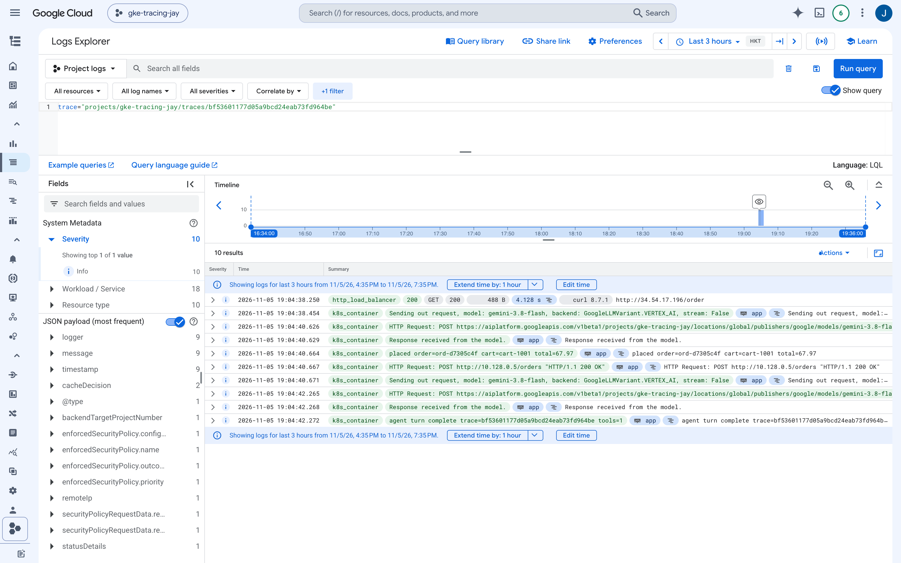

10 results: the External ALB access log (`http_load_balancer`, `200`, 4.128 s) and 9 `k8s_container` entries from both services (Gemini calls, `placed order=ord-d7305c4f`, `POST http://10.128.0.5/orders 200`). The join key is the trace ID itself; nothing had to be logged by hand.

---

## What this shows that a load balancer access log does not

| Capability | Google Cloud ALB (GKE Gateway + `TelemetryPolicy`) | Azure Application Gateway / AGC |
| :--- | :--- | :--- |
| Trace origin | LB mints W3C `traceparent` when the client sends none (Scenario A); when the client is traced, the LB span nests under the client span (Scenario H) | Trace starts at the Pod; gateway injects `X-Appgw-Trace-Id` (GUID, not W3C) and never appears as a child of the caller's span |
| LB hop in the waterfall | LB spans with their own timing next to app spans (G2: 1.508 s vs 1.504 s) | Gateway timing only in `AGWAccessLogs` (`timeTaken`, `serverResponseLatency`), joined manually |
| Requests that never reach a Pod | 403 / 404 / 503 spans in the same trace store (F, C, G1) | Access log and WAF log rows only |
| Sampling at the internal hop | Honors the W3C sampled flag (D) | No sampling decision at the gateway |
| Correlated logs | `trace=` query returns LB and container logs together (E, F) | App must log the gateway header; KQL join across tables |

Azure behavior above is as documented in the project plan; it was not re-verified against Azure docs on the day of this run.

## Reproduce the screenshots

1. Run `./scripts/04-run-demo-checks.sh` and copy the trace IDs it prints. For Scenario H, run the `06-run-otel-client.py` command above and copy its trace ID.
2. Edit the `TRACES` and `LOG_QUERIES` lists in `scripts/05-capture-screenshots.py`, or pass `stem=trace_id` arguments to capture individual traces (for example `11-scenario-h-otel-client=4ca3fbf78d8affe555d83ef34a8178eb`).
3. Run `uv run scripts/05-capture-screenshots.py [stem=trace_id ...]`; sign in to Google Cloud Console once in the Chrome window it opens. Screenshots are written to `docs/screenshots/`.
